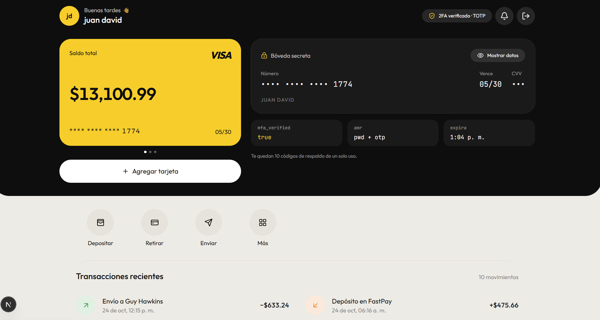
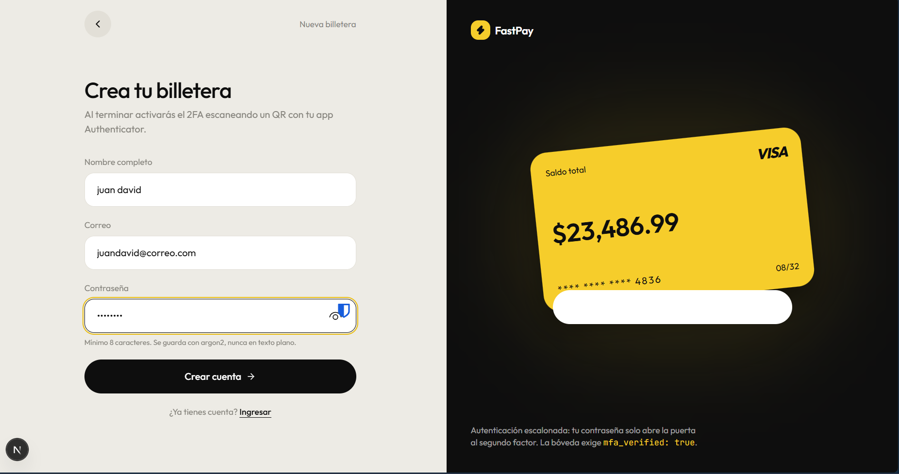
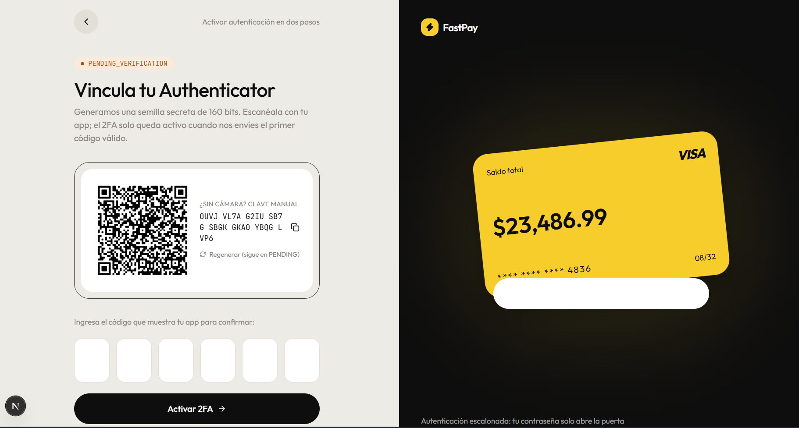
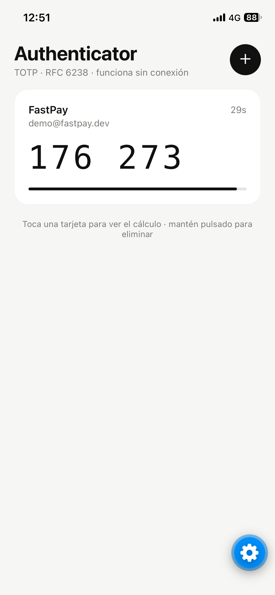
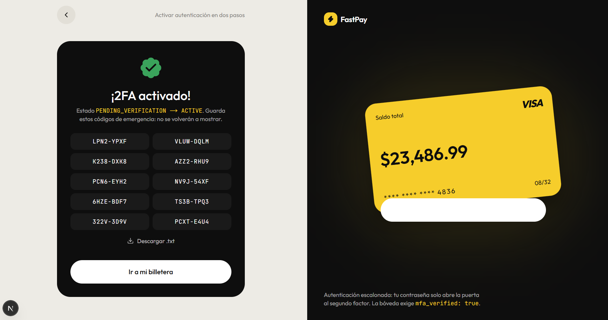
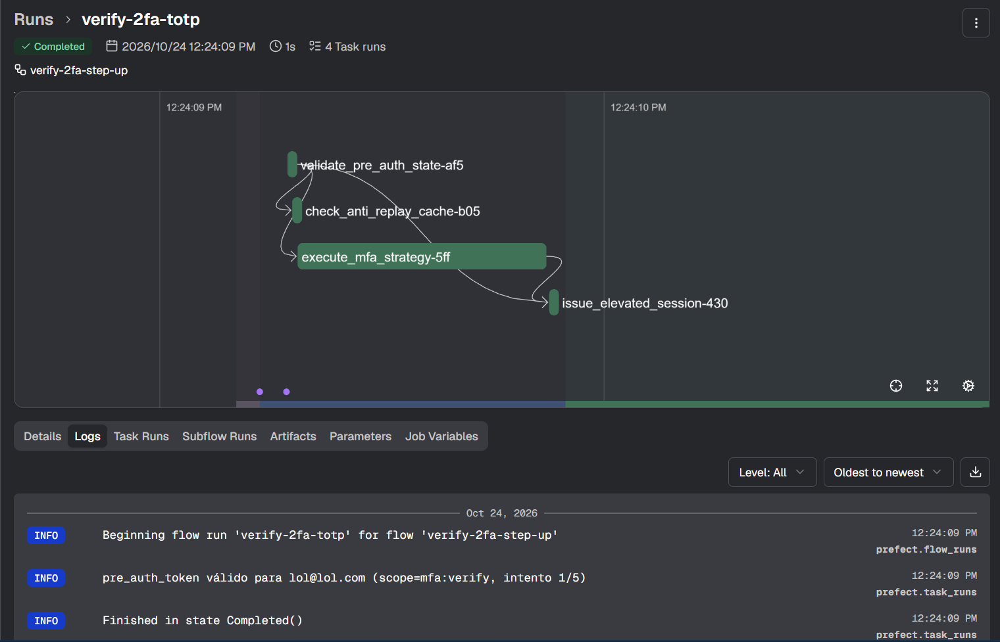

# Yellow Wallet · 2FA TOTP desde cero + Observabilidad con Prefect

> [!IMPORTANT]
> <ins>**✅ Proyecto revisado en clase por el profesor.**</ins>



Laboratorio de **Patrones Arquitectónicos Avanzados**. Es una billetera digital (estilo FastPay) cuya bóveda solo se abre
con **contraseña + código TOTP de 6 dígitos**. Ese código lo genera una **app móvil propia** que funciona en modo avión.
Cada paso del pipeline de autenticación es un `@flow` / `@task` observable en **Prefect**.

## El flujo en capturas

**1. Registro.** La contraseña se guarda con argon2. Al terminar, el backend responde `next_step = "enroll"`.



**2. Aprovisionamiento 2FA.** El enrolamiento nace en `PENDING_VERIFICATION`. El QR lleva la URI `otpauth://totp/...` con
la semilla de 160 bits en Base32. Si no hay cámara, la semilla se puede escribir a mano.



**3. App Authenticator propia** (React Native + Expo, en un iPhone). Calcula el código desde cero y lo renueva cada 30 s,
sin conexión.

<p align="center">
  
</p>

**4. Primer código válido → `ACTIVE`.** Se generan 10 códigos de respaldo de un solo uso (`BackupCodeStrategy`), que se
muestran una única vez.



**5. Observabilidad en Prefect.** Cada verificación es un flow `verify-2fa-step-up` con sus 4 tasks. Los logs muestran el
estado del `pre_auth_token`, la caché anti-replay y la ventana TOTP que coincidió.



**6. La bóveda.** `GET /api/boveda-secreta` solo responde con un `access_token` que tenga `mfa_verified: true` y
`amr: pwd + otp` (ver la captura del inicio).

```
.
├── mobile-authenticator/   App Authenticator (React Native + Expo): TOTP RFC 6238 escrito a mano
├── backend-prefect/        API FastAPI + flows de Prefect (Step-Up, Strategy, Process Manager)
├── web-app/                Web Next.js estilo FastPay; su servidor actúa como BFF del backend
└── docker-compose.yml      Prefect Server + backend + web
```

## Arquitectura

```
 iPhone (modo avión)                         Navegador
 ┌───────────────────────┐                   ┌──────────────────────────────┐
 │ Authenticator (Expo)  │  el usuario       │ web-app (Next.js)            │
 │ HMAC-SHA1(K, ⌊t/30⌋)  │ ─ teclea 6 ─────▶ │ Server Actions = BFF         │
 │ truncamiento dinámico │   dígitos         │ JWT en cookies httpOnly      │
 └───────────────────────┘                   └──────────────┬───────────────┘
        ▲  QR otpauth://totp/...                            │ REST (servidor a servidor)
        │  (una sola vez, al enrolar)                       ▼
        │                                    ┌──────────────────────────────┐      ┌───────────────────┐
        └────────────────────────────────────│ backend-prefect (FastAPI)    │─────▶│ Prefect Server UI │
                                             │ cada endpoint = 1 @flow      │ runs │ :4200             │
                                             └──────────────┬───────────────┘      └───────────────────┘
                                                            │ psycopg (pooler sesión 5432)
                                                            ▼
                                             Supabase Postgres · schema mfa_lab
```

El teléfono y el backend **nunca se comunican**. Comparten la semilla una única vez, por el QR, y desde ese momento cada
lado calcula el mismo código usando solo su propio reloj.

### Flujo de verificación (`POST /auth/verify-2fa`)

| # | `@task` | Qué hace | Si falla |
|---|---|---|---|
| 1 | `validate_pre_auth_state` | Valida el JWT `pre_auth` (firma, expiración, `typ`, `scope=mfa:verify`), que no se haya canjeado ya y que no supere 5 intentos | `InvalidPreAuthToken` / `TooManyAttempts` |
| 2 | `check_anti_replay_cache` | Revisa si `(user_id, código)` ya se usó en los últimos 90 s | **`ReplayAttackDetected`** → flow en rojo |
| 3 | `execute_mfa_strategy` | Ejecuta `TOTPStrategy` o `BackupCodeStrategy`; deja en el log qué ventana coincidió (C-1, C o C+1) | `InvalidSecondFactor` |
| 4 | `issue_elevated_session` | Marca el código en la caché de forma atómica y emite el `access_token` con `mfa_verified: true` | `ReplayAttackDetected` (si hay carrera) |

Otros flows: `password-login`, `mfa-provisioning-start` y `mfa-provisioning-confirm`.

## Patrones implementados

| Patrón | Dónde |
|---|---|
| **Process Manager / Máquina de estados** | `backend-prefect/app/mfa/enrollment.py`. Las transiciones posibles son `SIN_2FA → PENDING_VERIFICATION → ACTIVE`; si se pide un QR nuevo antes de confirmar, el estado se queda en `PENDING_VERIFICATION`. Cualquier otra transición lanza `InvalidStateTransition`. Además, el `UPDATE ... WHERE status = 'PENDING_VERIFICATION'` impide pisar un enrolamiento `ACTIVE` desde la base. Si el usuario genera el QR y nunca lo escanea, no queda bloqueado: en el siguiente login vuelve al paso de enrolar. |
| **Step-Up Authentication** | `POST /auth/login` nunca da acceso: devuelve un `pre_auth_token` (`typ=pre_auth`, 5 min, `scope` = `mfa:enroll` o `mfa:verify`). Solo `verify-2fa` o `2fa/confirm` lo canjean (una sola vez) por un `access_token` (`typ=access`, `mfa_verified: true`, `amr: [pwd, otp]`). `GET /api/boveda-secreta` rechaza cualquier token que no sea de ese tipo. |
| **Strategy** | `backend-prefect/app/mfa/strategies.py`: la interfaz `SecondFactorStrategy` tiene dos implementaciones, `TOTPStrategy` (ventanas C-1/C/C+1 con `hmac.compare_digest`) y `BackupCodeStrategy` (quema el código con un `UPDATE` atómico). La fábrica `_build_strategy` es el único lugar del código que conoce las clases concretas. |
| **Idempotencia / Anti-Replay** | `backend-prefect/app/mfa/memory_store.py`: un `TTLSet` de 90 s protegido con un `Lock`. Tiene una lectura previa en la task 2 y un *check-and-set* atómico en la task 4, así que dos peticiones simultáneas con el mismo código no pueden pasar las dos. |
| **BFF** | `web-app/src/app/actions.ts`: el navegador nunca ve los JWT. Los guarda el servidor de Next en cookies `httpOnly` + `SameSite=Strict`. |

### Seguridad adicional

- Contraseñas hasheadas con **argon2**. Si el email no existe, igual se compara contra un hash de relleno para que el tiempo de respuesta no revele qué cuentas existen.
- El secreto TOTP se guarda **cifrado en reposo** (Fernet). Los códigos de respaldo se guardan solo como HMAC-SHA256 con pepper.
- El schema `mfa_lab` no se expone en la API de Supabase (`revoke` a `anon`/`authenticated`) y tiene RLS activado sin políticas.
- Los parámetros sensibles de los flows son `SecretStr`, así que Prefect los muestra enmascarados en la UI. En los logs los códigos aparecen como `28••82`.

## App móvil: TOTP desde cero

`mobile-authenticator/src/totp/`:

1. `base32.ts`: decodificador Base32 escrito a mano.
2. `counterAt`: calcula `C = ⌊UnixTime / 30⌋`.
3. `counterToBytes`: empaqueta C en 8 bytes Big-Endian (en dos mitades de 32 bits, porque los operadores de bits de JS son de 32 bits).
4. `hmac(sha1, K, C)`: es lo **único** que se toma de una librería (`@noble/hashes`, primitiva criptográfica permitida por la guía).
5. Truncamiento dinámico: `offset = hash[19] & 0x0f`, 4 bytes, `& 0x7f` y `% 1_000_000` con relleno de ceros a la izquierda.

Para comprobarlo contra los vectores oficiales del RFC 6238: `cd mobile-authenticator && npm run verify`.
En la app, al tocar una tarjeta se ven C, el HMAC completo, el offset y los 4 bytes extraídos, lo que sirve para explicarlo en la sustentación.

---

## Puesta en marcha

### Requisitos

- Docker Desktop (para la opción A) o Python 3.13 + Node 24 (para la opción B)
- Expo Go en el iPhone, en la misma red wifi que el PC
- `backend-prefect/.env`: copiar `backend-prefect/.env.example` y llenarlo (Supabase + secretos)

### Opción A: Docker (recomendada)

```bash
# Una sola vez: crea el schema mfa_lab en Supabase y el usuario demo
docker compose --profile setup run --rm setup

# Levanta Prefect Server + backend + web
docker compose up --build
```

| Servicio | URL |
|---|---|
| Web FastPay | http://localhost:3000 |
| API (Swagger) | http://localhost:8000/docs |
| Prefect UI | http://localhost:4200 |

### Opción B: local, sin Docker

```bash
# Terminal 1: Prefect
cd backend-prefect
python -m venv .venv && .venv\Scripts\activate      # Windows (en macOS/Linux: source .venv/bin/activate)
pip install -r requirements-dev.txt
prefect server start

# Terminal 2: backend
cd backend-prefect && .venv\Scripts\activate
python -m scripts.migrate && python -m scripts.seed_demo
uvicorn app.main:app --port 8000

# Terminal 3: web
cd web-app && npm install && npm run dev            # http://localhost:3000
```

### App móvil (iPhone + Expo Go)

```bash
cd mobile-authenticator
npm install
npx expo start          # escanea el QR de Metro con la cámara del iPhone → abre en Expo Go
```

> **Modo avión con Expo Go:** abre primero la app con wifi (Expo Go descarga el bundle desde Metro) y **luego** activa el
> modo avión. A partir de ahí el cálculo TOTP es 100 % local: solo usa la semilla del llavero (Keychain) y el reloj.

### Usuario demo

`demo@fastpay.dev` / `FastPay2026!`. No tiene 2FA, así que el primer login lleva al enrolamiento con QR.
Para repetir la demo desde cero: `python -m scripts.reset_mfa demo@fastpay.dev`
(con Docker: `docker compose run --rm backend python -m scripts.reset_mfa demo@fastpay.dev`).

### Pruebas

```bash
cd backend-prefect && pytest                    # RFC 6238, ventanas, máquina de estados, anti-replay
cd mobile-authenticator && npm run verify       # RFC 6238 en la implementación de la app
cd backend-prefect && python -m scripts.e2e_demo http://localhost:8000   # flujo completo contra la API viva
```

---

## Guion de la sustentación (las 4 pruebas)

1. **Paridad estándar.** En la web, *Comenzar* → registrarse → *Generar código QR*. Escanear el mismo QR con esta app **y**
   con Google/Microsoft Authenticator: las dos muestran los mismos 6 dígitos al mismo tiempo.
2. **Modo avión.** Activar el modo avión en el iPhone, esperar a que cambie la ventana de 30 s, ingresar el código en la
   web → `/wallet` muestra los datos de `GET /api/boveda-secreta`.
3. **Anti-Replay.** Cerrar sesión, iniciar sesión de nuevo y enviar **el mismo código** antes de que pasen 90 s. La web
   muestra "Ataque de repetición bloqueado" y en Prefect el flow `verify-2fa-step-up` queda **Failed** en la task
   `check_anti_replay_cache`.
4. **Clock skew o respaldo.** En Prefect → flow run → logs de `execute_mfa_strategy`: `✅ Match TOTP en la ventana C-1 …
   el reloj del teléfono va ~30 s ATRASADO`. Alternativa: en la web elegir *Código de respaldo* y usar uno de los 10
   códigos que se mostraron al activar el 2FA.

## Endpoints

| Método | Ruta | Requiere | Flow |
|---|---|---|---|
| POST | `/auth/register` | — | — |
| POST | `/auth/login` | email + password | `password-login` |
| POST | `/auth/2fa/enroll` | `pre_auth_token` (scope `mfa:enroll`) | `mfa-provisioning-start` |
| POST | `/auth/2fa/confirm` | `pre_auth_token` (scope `mfa:enroll`) + código | `mfa-provisioning-confirm` |
| POST | `/auth/verify-2fa` | `pre_auth_token` (scope `mfa:verify`) + código + `method` | `verify-2fa-step-up` |
| GET | `/api/boveda-secreta` | `Authorization: Bearer <access_token>` con `mfa_verified: true` | — |

> Alcance de laboratorio: la caché anti-replay y los contadores viven en memoria (un solo worker de uvicorn). En
> producción irían en Redis (`SET NX EX`).
